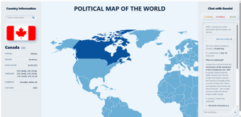
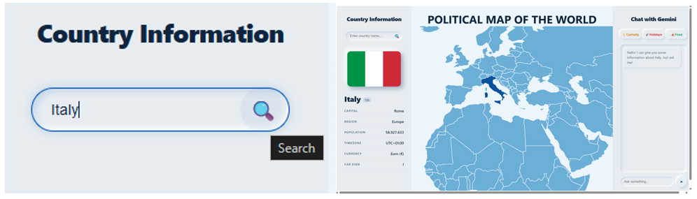
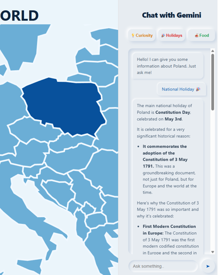

<p align="center">
  
</p>

<h1 align="center">🌍 fAInd-it! — World Country Explorer & AI Trivia</h1>

> ⚠️ **Project Status: Archived / Unmaintained**  
> **Please Note:** This project is no longer actively maintained and is currently non-functional in a live environment due to breaking changes and deprecations in the external APIs it relies upon. This repository remains public strictly as an architectural and code showcase of past work, demonstrating the implementation of the **Model-View-ViewModel (MVVM)** pattern in a React Single-Page Application.

---

## 📖 Overview

**fAInd-it!** is a React Single-Page Application (SPA) built using the **MVVM pattern** to explore global country trivia. It integrates the **REST Countries API** for core data, the **Google Gemini API** for interactive LLM queries, and a **D3.js-rendered GeoJSON map** (originally fetched via a remote API and later migrated to local files for better performance).

---

## ✨ Key Features

* **Interactive World Map:** Visualizes countries globally using D3.js and GeoJSON data, allowing users to select and inspect different regions interactively.
* **Comprehensive Country Profiles:** Displays demographic, geographical, and general facts fetched dynamically from the REST Countries API.
* **AI-Powered Curiosities:** Integrates Google Gemini (LLM) to let users ask custom follow-up questions or use quick-action prompts (`Curiosity`, `Holidays`, `Food`) to discover deeper, context-aware trivia about the selected country.
* **Clean MVVM Architecture:** Strictly separates data handling (`models`), UI state and business logic via custom React hooks (`viewmodels`), and presentation components (`views`).

---

## 🛠️ Tech Stack & Integrations

* **Frontend Framework:** React (Vite)
* **Architectural Pattern:** Model-View-ViewModel (MVVM)
* **Styling:** CSS Modules (`*.module.css`) & standard CSS
* **Data Visualization:** D3.js (GeoJSON rendering)
* **External APIs & Data Sources:**
  * [REST Countries API](https://restcountries.com/) — For demographic and country metrics.
  * **Google Gemini API** — For interactive LLM trivia generation.
  * **GeoJSON Data** — Initially queried from a remote endpoint, subsequently migrated to local static assets to eliminate network bottlenecks and improve map rendering performance.

---

## 📂 Project Structure

The codebase strictly adheres to the **Model-View-ViewModel (MVVM)** separation of concerns, organized as follows:

```text
├── docs/
│   └── images/                            # Showcase screenshots & logo for README
├── public/
├── src/
│   ├── assets/
│   ├── components/
│   │   ├── models/                        # Data layer & API service abstractions
│   │   │   ├── countryModel.js            # Handles REST Countries API data structures
│   │   │   ├── geminiModel.js             # Manages Google Gemini API requests/payloads
│   │   │   └── mapModel.js                # Handles local GeoJSON map data
│   │   │
│   │   ├── viewmodels/                    # Business logic & state management (Custom Hooks)
│   │   │   ├── geminiViewModel.js         # State & logic for AI prompt handling
│   │   │   ├── useCountrySearchViewModel.js # Search logic & country data binding
│   │   │   └── useWorldMapViewModel.js    # D3 map interaction & coordinate logic
│   │   │
│   │   └── views/                         # Presentation layer (UI Components)
│   │       ├── compoundViews/             # Composite UI views
│   │       ├── CountryInformation.jsx     # Displays core facts for a selected country
│   │       ├── CountryInformation.module.css
│   │       ├── GeminiView.jsx             # Chat/Query interface for Gemini LLM
│   │       ├── GeminiView.module.css
│   │       ├── WorldMap.jsx               # D3.js interactive map component
│   │       └── WorldMap.module.css
│   │
│   ├── tests/                             # Unit and integration tests
│   ├── utilities/                         # Helper functions and shared utilities
│   ├── App.css
│   ├── App.jsx                            # Root application component
│   └── main.jsx                           # Application entry point
└── .env                                   # Environment variables (API keys)
```

---

## 🏛️ Architectural Highlights (MVVM in React)

To keep the codebase modular, testable, and easy to scale, this project implements MVVM using React idioms:

1. **Models (`src/components/models/`):** Pure JavaScript modules responsible for fetching, parsing, and formatting data from the REST Countries API, the Gemini API, and the local GeoJSON files. They have no knowledge of the user interface.
2. **ViewModels (`src/components/viewmodels/`):** Implemented primarily as custom React Hooks (`useCountrySearchViewModel`, `useWorldMapViewModel`, `geminiViewModel`). They act as the bridge between the Models and the Views—managing React state, side effects, and user input validation while exposing clean state variables and action handlers.
3. **Views (`src/components/views/`):** Declarative `.jsx` components styled with CSS Modules. They remain purely focused on rendering the UI based on the props and state provided by the ViewModels.

---

## ⚙️ Local Setup (For Reference Only)

*As noted above, running the project locally today will result in API errors due to upstream changes in the external services. However, for reference, the project was originally configured and run using the following steps:*

1. **Clone the repository:**
   ```bash
   git clone <repository-url>
   cd <project-folder>
   ```

2. **Install dependencies:**
   ```bash
   npm install
   ```

3. **Configure environment variables:**
   Create a `.env` file in the root directory and add your Google Gemini API key:
   ```env
   VITE_GEMINI_API_KEY=your_api_key_here
   ```

4. **Start the development server:**
   ```bash
   npm run dev
   ```

---

## 📸 Gallery

*Since a live deployment is no longer available, the gallery below showcases the application's interface and core workflows as they originally functioned.*

### Main Dashboard & Interactive World Map



*Selecting any country highlights it dynamically on the D3.js political map, populates demographic and geographic details on the left panel, and initializes a context-aware Gemini chat on the right.*

### Country Search & Profile View



*Users could either click directly on the map or use the search bar to locate a country and view its flag, capital, region, population, timezones, currency, and international vehicle registration code.*

### Context-Aware AI Chat (Google Gemini)

<p align="center">
  
</p>

<p align="center">
  <em>The right-hand panel provided one-click quick prompts (<strong>Curiosity</strong>, <strong>Holidays</strong>, <strong>Food</strong>) alongside a free-form chat input for tailored follow-up questions.</em>
</p>